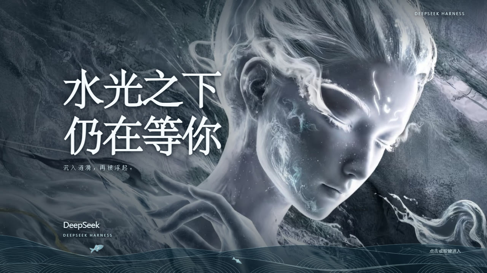
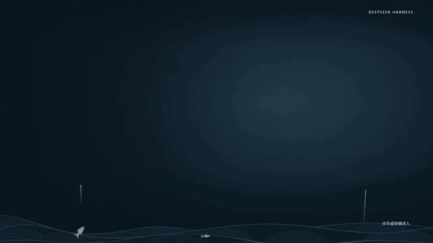

# DSH Entrance · Heavenstep（水光之下）



为 DeepSeek Harness 加上一段「水光之下」的个人入场：冷银蓝的水光场景分层铺开，
跃水鱼群与微光相伴，点击或按键后由同一道水波把画面擦除、交接到真实工作台。



[](https://github.com/manyerror/dsh-entrance-heavenstep/actions/workflows/ci.yml)

## 安装到 DSH

1. 在 DSH 插件管理页选择 **“添加插件”**。
2. 在 **“包名或地址”** 中填写：

   ```text
   https://github.com/manyerror/dsh-entrance-heavenstep
   ```

3. 安装后启用 **`dsh-entrance-heavenstep`**，即可使用这段水光入场。

仓库包含**预构建客户端**，普通安装不需要构建，也不需要模型 API 或远程图片服务。
右上角仅保留一个低对比度的“动画设置”入口，重播放在设置面板中；也可按 `Alt+Shift+W`
打开设置。宿主设置页另有“入场动画”分区。已有启动弹窗或用户已经开始输入时，会跳过本轮自动欢迎。

> **不要与上游 `dsh-entrance` 同时启用。** 本插件在检测到自己的控制器或上游
> `dsh-entrance` 控制器时不会重复挂载，也会避让已存在的欢迎层；但两者共用快捷键与相似的
> 设置入口，只启用其中一个最清晰。

## 这段入场做了什么

- **分层登场**：设计时间 `0…2.4` 内依次铺开——底部冷色波带与场景先建立，主视觉落位，
  随后标题与品牌形成层级；默认展开时长 `3.2 s`。
- **水波交接**：退出不是“先淡出再播水纹”。水纹的位置决定欢迎画面哪里还可见：
  水体与欢迎层遮罩消费同一个时钟、同一个原点、同一个 `welcomeWaterWaves()` 几何，
  三道波前经过后剩余可见度依次为 `100% → 56% → 20% → 0%`，从指针位置扩散；
  键盘退出取画面中心。
- **可读性优先**：主视觉之上有一层暗角，标题与品牌在深浅底上都保持可读；字号随
  `min(cqw, vh)` 自适应，矮宽窗口下不会挤压副题。
- **静态主体**：主视觉是一张完整场景图，按原比例整层呈现（保留原背景的画框式构图），
  因此**没有**挥手、眨眼等局部动作，也未做抠图。
- 关闭动画或开启系统“减少动态”时保留静态构图，退出立即完成。

## 可调内容

| 控件 | 范围/默认 | 含义 |
| --- | --- | --- |
| 欢迎动画 | 开 / 关 | 总开关，控制场景展开与游鱼 |
| 自动欢迎 | 开 / 关 | 打开应用时是否显示欢迎场景 |
| 烟花绽放 | 开 / 关 | 入场期间的冷色光点 |
| 游鱼跃水 | 开 / 关 | 底部错峰跃水与短水纹 |
| 烟花亮度 | `0–100%`，默认 `50%` | 中点保留基准效果，最大值提高发光强度 |
| 游鱼跃起幅度、速度 | 各 `0–100%`，默认 `50%` | 幅度与速度独立，起落回到水面 |
| 游鱼数量 | `2 / 3`，默认 `3` | 大小、轮廓与配色不同 |
| 展开时长 | `1.5–5.0 s`，默认 `3.2 s` | 不含停留与固定的 `2.2 s` 水波退出 |

`100%` 为两倍基准参数增益，不代表感知亮度线性翻倍；`0%` 对应熄灭或停止相关动作。
本作品没有挥手与飘带，因此设置面板**不显示**对应控件；旧偏好字段仍保留以兼容既有记录。
偏好保存在当前浏览器/宿主 origin 的 `localStorage`（键 `dsh.entrance-heavenstep.preferences.v2`），
下次重播生效。

## 本地预览与开发

需要 Node.js **22 或更高版本**。在仓库根目录执行：

```sh
pnpm install --frozen-lockfile
pnpm run build
pnpm test
pnpm run preview
```

终端显示预览地址，默认端口 `4320`；这是含示例输入框与计数器的浏览器工作台，`Ctrl+C` 停止。
`npm install` 也可作为便捷路径，但仓库锁文件是 `pnpm-lock.yaml`。

修改 `lib/client/` 后重新构建，**不要手改**生成文件 `lib/client.js`：

```sh
pnpm run check
pnpm exec playwright install chromium
pnpm run test:browser
```

报告与截图输出至 `test-results/`，覆盖独立控制器、素材服务、设置持久化、退出焦点恢复、
长按防穿透、减少动态与窄屏布局。**浏览器检查不能代替原生 Electron 的视觉与帧率验收。**

`pnpm pack --pack-destination dist` 生成按 `package.json` 版本命名的本地 `.tgz`；
`pnpm run check:package` 核对包内源文件与素材哈希并写出 `SHA256SUMS`。打包不等于发布。

## CI 与版本发布

CI 对 `main` 和 Pull Request 检查锁定依赖安装、构建一致性、单元测试、Chromium 浏览器行为
及实际安装包内容。报告、截图、安装包与校验文件作为运行产物保留。

发版时更新 `package.json`、[CHANGELOG](CHANGELOG.md)，提交首行使用 `release: v版本`；
普通提交不发版，已发布版本不覆盖。

## 文档与验证

| 想了解 | 文档 |
| --- | --- |
| 本次个人作品的来源、设计与检查 | [个人入场记录](docs/PERSONAL-ENTRANCE.md) |
| DIY 构思、素材、接入 | [创作流程](docs/CREATIVE-WORKFLOW.md) · [素材规格](docs/ASSET-SPEC.md) · [模板指南](docs/TEMPLATE-GUIDE.md) |
| 动画与工程实现 | [架构](docs/ARCHITECTURE.md) · [分镜](docs/STORYBOARD.md) · [水波退出](docs/WATER-EXIT.md) |
| 检查和已知问题 | [验收标准](docs/ACCEPTANCE.md) · [问题总结](docs/LESSONS-LEARNED.md) |
| 环境和素材来源 | [平台适配](docs/PLATFORM-GUIDE.md) · [素材说明](docs/ASSETS-LICENSE.md) · [素材许可](LICENSE-ASSETS) |

本仓库当前工作副本的检查结果：`pnpm run build` 与 `pnpm run check` 通过、
单元测试 `16/16`、浏览器检查 `36/36`、安装包源文件与素材哈希校验通过（Windows / Node v22.20.0）。
**原生 DSH / Electron 宿主尚未验收**，浏览器预览不能替代原生证据；其他系统、设备与
DSH 版本未测。

## 许可与素材边界

代码与代码文档采用 [MIT](LICENSE)。**素材不在 MIT 范围内，本仓库不授予任何素材权利。**

- `lib/assets/entrance/20261010/hero.jpg` 是本作品的主视觉，**由使用者提供**；
  本仓库未核实其来源、C2PA 记录或再分发权利。
- `docs/media/heavenstep-*.gif` 与 `heavenstep-preview.jpg` 是本作品的实际渲染录屏与截图，
  同样不在 MIT 范围内。
- `lib/assets/entrance/20261006/*.png` 与 `docs/media/demo.gif` 是**上游示例素材**，
  仅供对照与素材规格参考，**本作品不引用它们**。

公开发布或再分发前，请替换成你**有权使用**的素材，并保留准确来源与 AI 生成说明。
完整清单与 SHA-256 见 [LICENSE-ASSETS](LICENSE-ASSETS)、[NOTICE](NOTICE.md) 与
[素材说明](docs/ASSETS-LICENSE.md)。

## 来源与致谢

本项目是 [AAAholic/dsh-entrance](https://github.com/AAAholic/dsh-entrance) 的衍生作品：
沿用其分层分镜时钟、`welcomeWaterWaves()` 水波几何、控制器（焦点恢复、输入屏障、
长按防穿透、后台暂停、减少动态、销毁）与测试/打包流程，并按本次个人素材重写了场景、
角色层、底部波带与配色，同时把插件标识改为 `dsh-entrance-heavenstep` 以支持独立安装。

上游项目提取自 [vlln/whale-girl](https://github.com/vlln/whale-girl) 扩展，保留其 MIT 声明。
本项目为**非官方**社区作品，与 DeepSeek、上游作者及任何角色权利方无隶属或背书关系。
